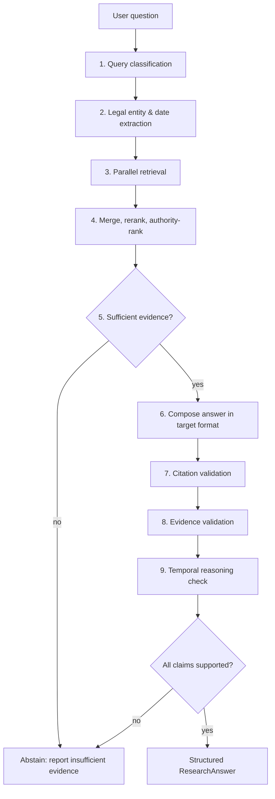

# AI Research Specification

Status: Gate 0 specification
Owners: Legal AI working group
Last updated: 2026-11-09
Sources: research dossier Sections 9.2 and 11.

This document specifies the **AI orchestration** layer: how a legal question
becomes a grounded, cited, temporally correct answer — or an explicit abstention.
It covers query classification, legal entity and date extraction, parallel
retrieval, citation validation, evidence validation, temporal reasoning, the
uncertainty/abstention policy, the structured answer JSON schemas for the legal
research / educational (ALAC/IRAC) / professional formats, and the
provider-neutral model gateway interface. It is the reference for
`@phli/ai-orchestrator`.

## 1. Design principles

1. **Grounded or silent.** An answer is built only from retrieved, citable
   evidence. If the evidence is insufficient, the system abstains rather than
   guessing.
2. **Every claim is cited.** Each substantive claim maps to an authority that
   survived citation and evidence validation.
3. **Temporal correctness.** Answers are stated as of a date, and authorities
   are filtered to those in force at that date.
4. **Provider-neutral.** The model gateway is an interface; models are routed by
   intent and capability, never referenced by a vendor-specific contract.
5. **Uncertainty is surfaced, not hidden.** Low confidence, conflicting
   authorities and gaps are reported to the user.

## 2. Retrieval and reasoning sequence

The orchestrator runs the following stages. The first four are retrieval and
analysis; the last three are generation and validation.



### 2.1 Query classification

The first stage classifies the question so the rest of the pipeline can be
tuned. Classification decides:

- **Intent** — `case_lookup`, `statute_lookup`, `doctrine`, `procedure`,
  `definition`, `comparison`, `drafting`, `education`, `general`.
- **Format** — `legal_research`, `educational` (ALAC/IRAC), or `professional`.
- **Retrieval mode** — `quick`, `standard`, `deep`, `comparison`, `statutory`,
  `educational`, `professional` (see `SEARCH_SPECIFICATION.md`).
- **Breadth** — how many parallel retrieval fan-outs and how deep the paging.

Classification may be rule-based, model-based, or a hybrid. Its output is
recorded on the trace so a run is reproducible and auditable.

### 2.2 Legal entity and date extraction

Before retrieval, the query is parsed into structure:

- **Legal entities** — case names, G.R. numbers, statute numbers (`RA 11232`,
  `BP 22`, `PD 442`), rules and provisions (`Rule 45`, `Article III, Section 1`),
  agencies and courts.
- **Legal entity and date extraction** also normalizes party names
  (`People of the Philippines v. X`) and resolves aliases.
- **Dates** — explicit dates, relative dates (`“as of 2010”`, `“before the 1987
  Constitution”`) and implicit temporal anchors become an `asOfDate` for
  point-in-time retrieval.
- **Jurisdiction and forum** — defaults to the Philippines; a local ordinance
  query narrows jurisdiction.

Extracted entities seed the lexical leg (exact identifiers) and the metadata
filters (court, agency, document type, date range).

### 2.3 Parallel retrieval

The orchestrator issues retrieval legs in parallel, not in series, to bound
latency:

- The lexical leg (identifiers, exact names) and the semantic leg (natural
  language) run concurrently over the same corpus.
- For `deep` and `comparison` modes, the query is expanded into multiple
  sub-queries (per authority, per provision, per jurisdiction) that also run in
  parallel.
- Each leg returns candidates that are merged by rank fusion and then reranked
  and authority-ranked exactly as specified in `SEARCH_SPECIFICATION.md`.

Parallel retrieval is what lets a single question consult case law, statutes,
rules and regulations at once while keeping wall-clock latency dominated by the
slowest leg, not their sum.

### 2.4 Citation validation

Every authority the model wants to cite is validated before it may appear in the
answer. Validation has four layers (mirrored by `@phli/citation-engine`):

1. **Identity** — the cited document exists and resolves to a canonical
   `documentId`.
2. **Location** — the cited provision/page actually contains the quoted or
   paraphrased proposition.
3. **Support** — the passage supports the claim made about it.
4. **Temporal** — the authority was in force at the answer's `asOfDate`.

A citation that fails any layer is either corrected against a verified source or
removed; an unsupported claim is removed with it (see §2.5). Detected conflicts
surface as `CONFLICT_DETECTED` and prevent a `high` confidence rating.

### 2.5 Evidence validation

Evidence validation is the gate between "we retrieved something" and "we may
answer". It checks that:

- Every substantive claim in the draft answer is traceable to one or more
  validated citations.
- No claim rests on an `UNVERIFIED` or `CONFLICT_DETECTED` authority without an
  explicit caveat.
- The retrieving passage set is sufficient to answer the question asked (not a
  nearby but different question).
- Quotes are verbatim against the validated source.

If a claim cannot be supported, the orchestrator removes the claim; if that
removes the substance of the answer, it abstains.

### 2.6 Temporal reasoning

Answers are stated as of a `asOfDate` (default: today). Temporal reasoning:

- Filters authorities to those in force at `asOfDate` (per
  `LEGAL_TEMPORAL_MODEL.md`, §6).
- Distinguishes promulgation, publication, effectivity, amendment and repeal
  dates and does not treat them as interchangeable.
- Flags when the applicable law changed materially around the relevant facts,
  and when a cited provision was later amended or repealed.
- Records the `asOfDate` on the answer so a reader knows what "current" means.

## 3. Uncertainty and abstention behaviour

The orchestrator must be willing to say "I don't know". Confidence is graded:

| Level | When |
| --- | --- |
| `high` | Multiple verified, in-force authorities agree; every claim supported. |
| `medium` | Evidence supports the answer but is thin, single-source or partly secondary. |
| `low` | Evidence is conflicting, stale, or requires assumptions the user did not state. |
| `insufficient` | The evidence does not answer the question; the system abstains. |

Abstention behaviour:

- **Abstain** when no retrieved passage supports the answer, when the question
  requires facts not in the corpus, or when authorities irreconcilably conflict.
- An abstention still returns the retrieved authorities (so the user can read
  them) and an `uncertaintyNotes` list explaining what is missing.
- **Never fabricate** a citation, a quotation or a holding. A hallucinated
  citation is treated as a defect, not an error to be papered over.
- Non-legal questions are declined, not answered from general knowledge.
- Advice that requires a licensed lawyer's judgment is framed as information,
  with a recommendation to consult counsel.

## 4. Structured answer schemas

All three formats share the `ResearchAnswer` envelope and populate exactly one
format-specific payload. The shapes below are normative; the TypeScript
definitions live in `packages/ai-orchestrator/src/types.ts`.

### 4.1 Envelope

```json
{
  "query": "Can an employer terminate an employee without notice?",
  "intent": "doctrine",
  "format": "legal_research",
  "answer": "…human-readable answer…",
  "citations": [
    {
      "documentId": "doc_…",
      "citationText": "G.R. No. …",
      "passage": "…",
      "verified": true,
      "validationLayers": ["identity", "location", "support", "temporal"]
    }
  ],
  "confidence": "high",
  "abstained": false,
  "uncertaintyNotes": [],
  "asOfDate": "2026-11-09",
  "legalResearch": { }
}
```

### 4.2 Legal research format

```json
{
  "format": "legal_research",
  "legalResearch": {
    "question": "…disambiguated research question…",
    "shortAnswer": "…front-loaded direct answer…",
    "holding": "…governing rule or holding…",
    "doctrine": ["…doctrine names…"],
    "applicableLaw": [
      {
        "documentId": "doc_…",
        "citationText": "G.R. No. …",
        "documentType": "COURT_DECISION",
        "issuingBody": "Supreme Court",
        "date": "2019-…",
        "verificationStatus": "VERIFIED",
        "relevance": "…"
      }
    ],
    "discussion": "…facts-to-law analysis…",
    "conclusion": "…"
  }
}
```

### 4.3 Educational format (ALAC / IRAC)

`framework` selects the structure. **IRAC** = Issue · Rule · Application ·
Conclusion. **ALAC** = Answer · Law · Application · Conclusion.

```json
{
  "format": "educational",
  "educational": {
    "framework": "IRAC",
    "irac": {
      "issue": "…",
      "rule": "…",
      "application": "…",
      "conclusion": "…"
    },
    "teachingNote": "…why the answer is contested or one-sided…",
    "followUpQuestions": ["…"]
  }
}
```

```json
{
  "format": "educational",
  "educational": {
    "framework": "ALAC",
    "alac": {
      "answer": "…",
      "law": "…",
      "application": "…",
      "conclusion": "…"
    }
  }
}
```

### 4.4 Professional format

A formal memorandum-style answer for practitioners.

```json
{
  "format": "professional",
  "professional": {
    "addressee": "…",
    "subject": "…",
    "issueStatement": "…",
    "briefAnswer": "…",
    "factsAssumptions": "…",
    "analysis": "…",
    "recommendations": ["…"],
    "riskFlags": ["…"]
  }
}
```

## 5. Model gateway interface

The gateway is provider-neutral (dossier Rule 2). Its interface is `ModelProvider`
in `@phli/ai-orchestrator`:

- `id`, `displayName`, `supports: ModelCapability[]`
- `generate(request: GenerationRequest): Promise<GenerationResult>`
- optional `generateStream(request): AsyncIterable<GenerationChunk>`
- optional `healthCheck(): Promise<ModelProviderHealth>`

A `GenerationRequest` carries the prompt, the detected `intent`, the target
`format`, the grounded `context` (retrieved passages the model may cite), and
sampling overrides. A `GenerationResult` carries the text, the provider-qualified
`model`, token `usage`, `finishReason`, latency and an `abstained` flag.

Routing rules:

- Pick the provider by required capability (`json_mode`, `streaming`,
  `system_prompt`) and by intent tier — cheap/fast models for `quick`, stronger
  models for `deep` and `professional`.
- No orchestration code may import a provider SDK directly; it goes through the
  gateway.
- A provider failure is retried with backoff, then failed over to another
  provider that advertises the same capability; the gateway records the failure.
- Structured output for the §4 schemas is requested with `responseFormat: "json"`
  and validated against the schema before it is accepted.

## 6. Evaluation

- **Classification** — intent/format/mode accuracy on a labelled fixture set.
- **Extraction** — entity and date extraction precision/recall (G.R., RA, rules,
  provisions, `asOfDate`).
- **Parallel retrieval** — the full evidence set is retrieved, not a subset.
- **Citation validation** — every citation in a passing answer is `verified`;
  seeded bad citations are caught.
- **Evidence validation** — unsupported claims are removed or the answer
  abstains.
- **Temporal reasoning** — a point-in-time query returns only in-force text.
- **Abstention** — out-of-corpus and non-legal questions are declined, always.
- **Accuracy gates** — the platform targets the 99% citation / 98% answer
  accuracy gates defined in the citation verification spec (dossier Section 10).

## 7. Risks and open questions

- **Model routing policy** is not final; tiers and failover order are an open ADR.
- **Reranker and embedding choice** affect citation accuracy; tracked in
  `KNOWN_LIMITATIONS.md`.
- **Multilingual queries** (Filipino) are not yet balanced with English.
- **Prompt injection from retrieved documents** is an untrusted-input problem;
  see `docs/architecture/DOCUMENT_INTELLIGENCE.md` §2 and the threat model.
