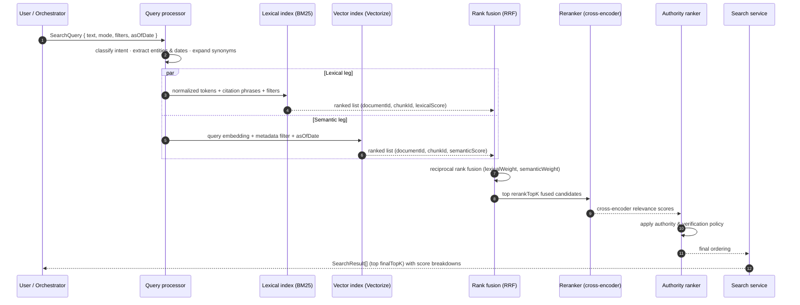

# Search & Retrieval Specification

Status: Gate 0 specification
Owners: Search & Retrieval working group
Last updated: 2026-11-09
Sources: research dossier Section 9.1–9.3; Cloudflare Vectorize and AI Search
documentation (retrieved 2026-11-09).

This document specifies the **hybrid retrieval** architecture for the platform:
how a query becomes a ranked set of grounded passages. It is the reference for
`@phli/legal-search` (see `packages/legal-search/src/types.ts`). It covers
lexical search, semantic search, metadata filtering, rank fusion, reranking and
the authority ranking policy, then records the Cloudflare Vectorize / AI Search
integration and its current limits.

## 1. Design principles

1. **Hybrid by default.** No single signal answers every legal query. A G.R.
   number, an RA number or an exact case name is best matched lexically; a
   natural-language question is best matched semantically. Both run, and their
   results are fused.
2. **Filter before rank.** Metadata constraints (court, document type,
   jurisdiction, date, agency, topic, verification status) are applied to the
   candidate set before scoring, never after.
3. **Authority is a ranking input, not a tie-breaker.** A verified, official
   primary source outranks an unverified secondary one at equal relevance.
4. **Temporal correctness.** A query may be anchored to an `asOfDate`; only
   provisions in force on that date are eligible (see
   `LEGAL_TEMPORAL_MODEL.md`, §6).
5. **Tenant isolation.** Retrieval is scoped by `tenantId` in a namespace or
   filter; no cross-tenant candidate may enter a ranking list.
6. **Provider-neutral contract.** `RetrievalConfig` and the `@phli/legal-search`
   interfaces describe behaviour, not a vendor. Cloudflare is the first adapter.

## 2. Hybrid retrieval architecture

A single query is answered by three cooperating mechanisms whose results are
merged and re-scored.

### 2.1 Lexical search (keyword / exact match)

Lexical search targets the identifiers and names where exact matching wins:

- **G.R. numbers** — `G.R. No. 123456`, `G.R. Nos. 123456-57`.
- **Statute numbers** — `Republic Act No. 11232`, `RA 11232`, `Batas Pambansa
  Blg. 22`, `Presidential Decree No. 442`, `Executive Order No. 292`.
- **Exact case names** — `Ang Ladlad LGBT Party v. Commission on Elections`.
- **Provision locators** — `Article III, Section 1`, `Section 5, Rule 45`.

Implementation is a BM25-style inverted index over normalized chunk text, with
special analyzers for citation tokens: number/letter classes are preserved,
ordinals are normalized (`G.R. No.` ≡ `G.R. Nos.`), and common citation prefixes
are kept as single phrases so a query for `RA 11232` does not match `RA 11233`.
Lexical results carry high precision on identifiers and near-zero recall on
paraphrase — which is exactly what the semantic leg supplies.

### 2.2 Semantic search (natural language)

Semantic search embeds the query and the corpus chunks into the same vector
space and returns nearest neighbours by cosine similarity.

- Natural-language questions (`“can my employer terminate me without notice?”`)
  and doctrinal questions (`“requisites of a valid warrantless arrest”`) are
  answered by meaning, not literal tokens.
- Embeddings are produced at ingestion time and stored in a vector index keyed by
  chunk id (see `DocumentChunk.embeddingId` in `LEGAL_DATA_MODEL.md`).
- Query embeddings are computed at request time with the same model and
  dimensions as the corpus; a model or dimension change requires a full re-index.
- Each vector carries its chunk metadata so the same index can serve metadata
  filtering without a second lookup.

### 2.3 Metadata filtering

Filters narrow the eligible corpus **before** scoring. They are expressed as
`SearchFilters` and matched against `ChunkMetadata`:

| Filter               | Applies to               | Example                                                               |
| -------------------- | ------------------------ | --------------------------------------------------------------------- |
| `court`              | Decisions, resolutions   | `Supreme Court`, `Court of Appeals`, `Sandiganbayan`                  |
| `documentType`       | Every document           | `CONSTITUTION`, `REPUBLIC_ACT`, `COURT_DECISION`, `AGENCY_REGULATION` |
| `jurisdiction`       | Every document           | `PH`, a local government unit code                                    |
| `dateRange`          | Promulgation/publication | `{ from: "1987-02-02", to: "2026-11-09" }`                            |
| `agency`             | Regulations, orders      | `BIR`, `SEC`, `DOLE`, `IC`                                            |
| `topic`              | Tagged material          | `labor`, `tax`, `criminal_procedure`                                  |
| `verificationStatus` | Trust gating             | `VERIFIED`, `PENDING_REVIEW`, `CONFLICT_DETECTED`                     |

`court`, `documentType`, `jurisdiction`, `agency`, `topic` and
`verificationStatus` are OR within a field and AND across fields. `dateRange` is
inclusive. A filter value that does not exist simply yields an empty candidate
set, never an unfiltered fallback.

### 2.4 Rank fusion

The lexical and semantic lists are combined into one candidate list before
reranking. The default is **Reciprocal Rank Fusion (RRF)**:

```
score(d) = Σ_s  w_s / (k + rank_s(d))        k = 60 (default)
```

where `s` ranges over the lexical and semantic signals, `w_s` is the per-signal
weight from `RetrievalConfig` (`lexicalWeight`, `semanticWeight`), and `rank_s(d)`
is the 1-based rank of document `d` in list `s`. RRF is rank-based, so it is
robust to the incomparable score scales of BM25 and cosine similarity.

Alternatives, selectable via `RetrievalConfig.fusion`:

- `weighted_score` — min-max normalise each list, then weighted sum. Simple, but
  sensitive to score distributions.
- `max_score` — take the best normalised score per document. Favours precision.

### 2.5 Reranking

The fused top `rerankTopK` candidates are re-scored by a cross-encoder reranker
that reads the query and the passage together. This is materially more accurate
than either leg alone and is what turns a fused candidate set into a final
ordering. Only a small candidate set is reranked because cross-encoders are
expensive per document. The top `finalTopK` reranked results are returned as
`SearchResult[]`, each with a `RetrievalScoreBreakdown`.

## 3. Retrieval sequence



## 4. Authority ranking policy

Relevance alone is not enough for legal work: a passage from an unofficial
mirror of a repealed statute must not outrank the Official Gazette text of the
statute currently in force. The authority ranker adjusts the reranker score by a
policy factor derived from these inputs, all available in `ChunkMetadata`:

1. **Authority level** — `official_primary` (the issuing body's own publication,
   e.g. the Official Gazette / Supreme Court E-Library) is highest;
   `official_secondary` (an official re-publication) next; `unofficial`
   (third-party mirrors, LawPhil-style aggregators) lowest.
2. **Verification status** — `VERIFIED` is promoted; `UNVERIFIED` and
   `PENDING_REVIEW` are held; `CONFLICT_DETECTED` and `DEFECTIVE_EXTRACTION` are
   demoted and surfaced with a warning rather than silently returned.
3. **Legal status** — `IN_FORCE` outranks `AMENDED`, `REPEALED`, `SUPERSEDED`
   and `EXPIRED`, so the currently effective text wins.
4. **Temporal fit** — when `asOfDate` is set, only versions/provisions in force
   at that date are eligible; a closer fit ranks higher.
5. **Source recency / freshness** — a recently re-retrieved manifestation of the
   same document ranks above a stale one (`LEGAL_TEMPORAL_MODEL.md`, §7).
6. **Court hierarchy** — for `COURT_DECISION` documents, Supreme Court > Court of
   Appeals > Sandiganbayan > regional trial courts, at comparable relevance.

The policy is a weighted adjustment applied after reranking, so it can never
resurrect a passage the reranker judged irrelevant. Factors and weights are
versioned config, not hard-coded, so ranking changes are auditable and testable.

## 5. Cloudflare Vectorize / AI Search integration

The first adapter of the retrieval contract is Cloudflare. Two products are
candidates:

- **Cloudflare Vectorize** — the vector database. This platform embeds chunks
  itself and stores them in a Vectorize index, then runs semantic search and
  metadata filtering directly. This is the default because it keeps full control
  over chunking, embeddings and reranking.
- **Cloudflare AI Search** — a managed search service that indexes a data source
  and answers natural-language queries with **hybrid search on by default**
  (semantic + keyword), metadata filtering and optional OCR. This is a
  lower-effort fallback for sources that fit a managed pipeline.

### 5.1 Current limits (cited)

From the Cloudflare Vectorize [Limits page](https://developers.cloudflare.com/vectorize/platform/limits/)
(last updated 2026-10-30) and the [AI Search overview](https://developers.cloudflare.com/ai-search/)
(last updated 2026-10-01):

| Limit                                                     | Current value                      | Consequence for this platform                                                                                                              |
| --------------------------------------------------------- | ---------------------------------- | ------------------------------------------------------------------------------------------------------------------------------------------ |
| Maximum dimensions per vector                             | **1536 dimensions** (32-bit float) | The embedding model must output ≤ 1536 dims. `text-embedding-3-small` (1536) fits; any larger model must be dimension-reduced or replaced. |
| Maximum returned results (`topK`) with values or metadata | **50**                             | One semantic call returns at most 50 candidates **with** metadata. A larger candidate set needs paging or namespaces.                      |
| Maximum returned results (`topK`) without values/metadata | 100                                | Use only when metadata can be fetched separately; not the default.                                                                         |
| Maximum vectors per index                                 | **20,000,000**                     | A single index holds up to 20M chunks. At our corpus scale this is ample, but it is the migration trigger if the corpus grows past it.     |
| Metadata per vector                                       | 10 KiB                             | Our `ChunkMetadata` fits comfortably; long passages are not stored as metadata.                                                            |
| Maximum metadata indexes per Vectorize index              | 10                                 | We need at most 7 filter fields; within budget.                                                                                            |
| Maximum namespaces per index                              | 50,000 (Paid) / 1000 (Free)        | Tenant isolation via namespaces caps free-tier tenants at 1000.                                                                            |
| Maximum upsert batch size                                 | 1000 (Workers) / 5000 (HTTP API)   | Ingestion batches chunks accordingly.                                                                                                      |

The `rerankTopK` default is therefore constrained to ≤ 50 per semantic call
unless paging is used; the default configuration uses `rerankTopK = 50` with
paging reserved for `mode: 'deep'`.

### 5.2 Integration notes

- **Metadata indexes** — create Vectorize metadata indexes for `documentType`,
  `court`, `jurisdiction`, `year`, `agency`, `verificationStatus` and `topic`
  (7 of the 10 allowed) so metadata filtering is index-backed, not post-filtered.
- **Namespaces** — namespace by `tenantId` for hard tenant isolation; use the
  metadata filter for the within-tenant facets.
- **Hybrid search** — AI Search enables [hybrid search](https://developers.cloudflare.com/ai-search/configuration/indexing/hybrid-search/)
  by default; when using AI Search instead of raw Vectorize, verify that rank
  fusion weights are configurable rather than trusting the default.
- **Metadata filtering** — AI Search supports custom metadata fields and
  [filtering](https://developers.cloudflare.com/ai-search/configuration/retrieval/filtering/);
  map `SearchFilters` field-for-field.
- **Search modes** — AI Search exposes configurable [search modes](https://developers.cloudflare.com/ai-search/concepts/search-modes/);
  map `RetrievalMode` onto the closest mode and document any mismatch.
- **Embedding model lock-in** — dimensions are fixed per index (≤ 1536). Record
  the model id and dimension in the index metadata; changing either requires a
  full re-embed and re-index.
- **Cost** — Vectorize, Queues and R2 usage are monitored (`KNOWN_LIMITATIONS.md`);
  the cost model is not final. Prefer free/local tiers in Gate 0.

## 6. Interface mapping

| Concept                | `@phli/legal-search` type |
| ---------------------- | ------------------------- |
| Incoming query         | `SearchQuery`             |
| Structured constraints | `SearchFilters`           |
| Returned passage       | `SearchResult`            |
| Index metadata         | `ChunkMetadata`           |
| Weights and cut-offs   | `RetrievalConfig`         |
| Retrieval shape        | `RetrievalMode`           |
| Fusion strategy        | `RankFusionMethod`        |
| Score breakdown        | `RetrievalScoreBreakdown` |

## 7. Evaluation

- **Lexical correctness** — a query for a known `G.R. No.` / `RA` number returns
  that document in the top 3.
- **Semantic recall** — a paraphrased doctrinal question retrieves the leading
  case(s) without the exact phrase.
- **Filter correctness** — a court/date filter never returns an out-of-filter
  document, and an impossible filter returns empty rather than unfiltered.
- **Authority ordering** — at equal relevance, `official_primary` outranks
  `unofficial`, and a `VERIFIED` in-force statute outranks a `REPEALED` mirror.
- **Fusion/rerank** — RRF + rerank beats either leg alone on the benchmark
  fixture set (Gate 0 establishes the fixture structure; effectiveness is scored
  later).

## 8. Risks and open questions

- **Dimension ceiling.** 1536 dims caps embedding quality; a higher-dimensional
  model would need a separate index or dimension reduction.
- **topK 50 cap.** Deep research needs paging or partitioned namespaces.
- **Reranker choice and cost.** No decision yet on a self-hosted vs. managed
  cross-encoder; recorded in `KNOWN_LIMITATIONS.md`.
- **Multilingual retrieval.** Filipino/Tagalog recall is not balanced with
  English (`KNOWN_LIMITATIONS.md`); a multilingual embedding model is under
  evaluation.
- **AI Search vs. raw Vectorize.** Whether to adopt the managed service or keep
  full control is an open ADR.
